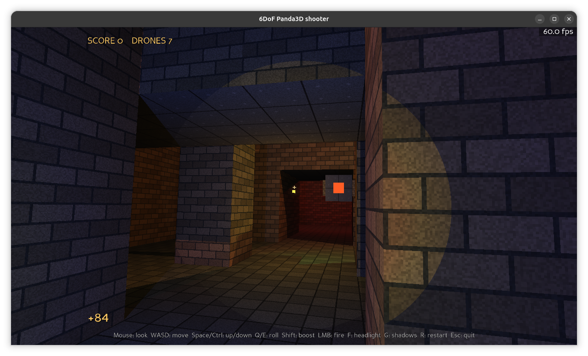
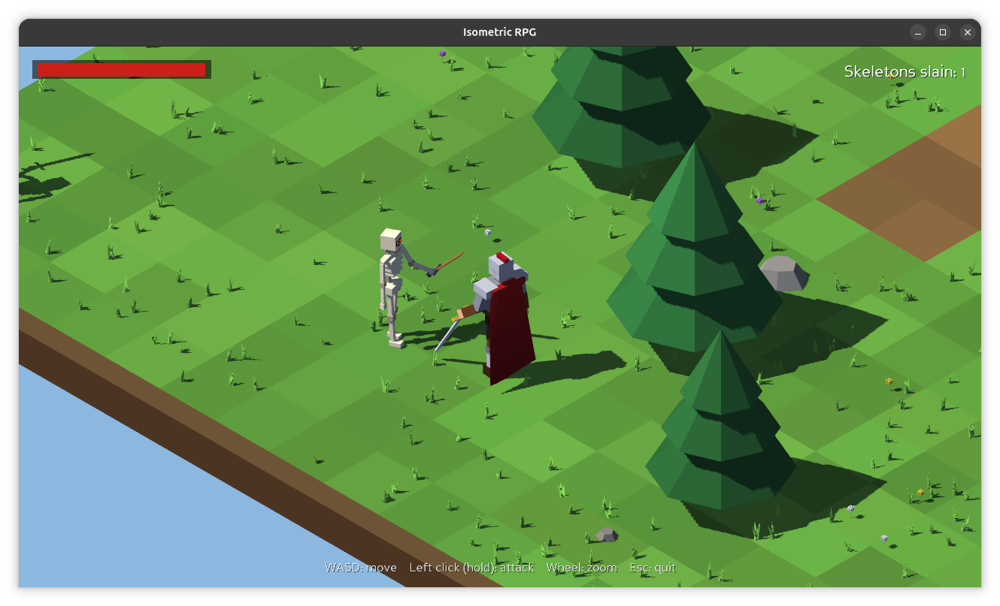
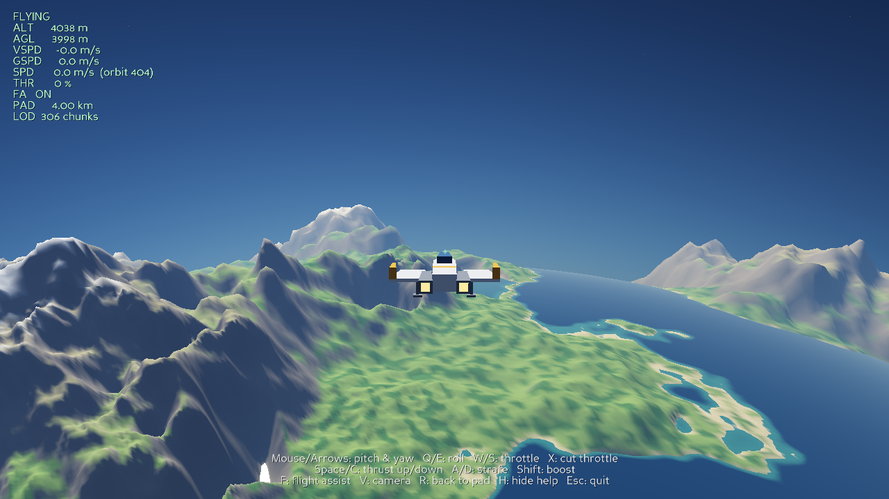
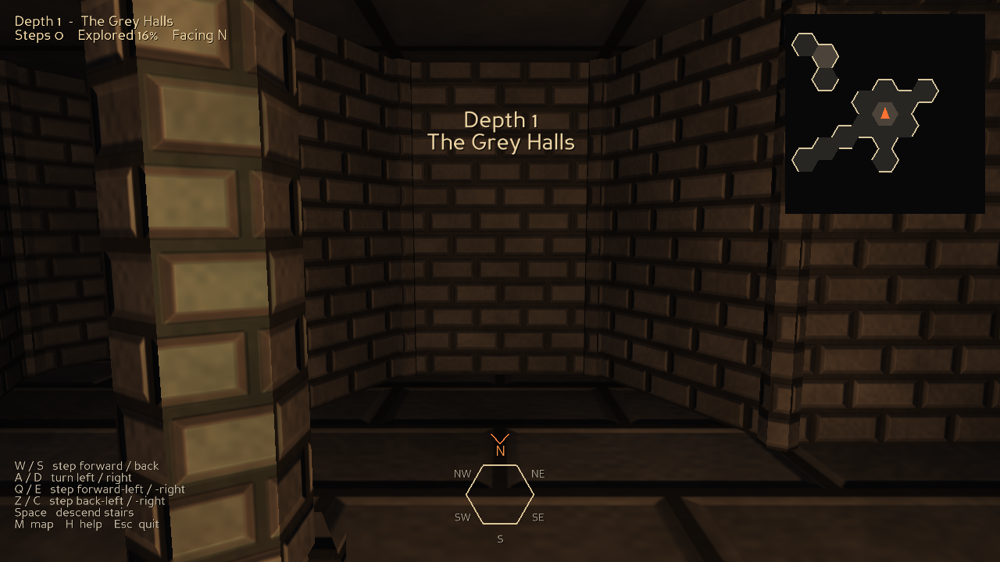

A collection of vibe coded games using [Panda3D](https://www.panda3d.org/).

I prompted a "6dof quake game" and an "isometric rpg" but tried to avoid mentioning specific games.

# 6dof_shooter

# isometric_rpg

# space_sim

# hex_dungeon_crawl

A first-person grid dungeon crawler on a hexagonal grid: six directions instead of four.
